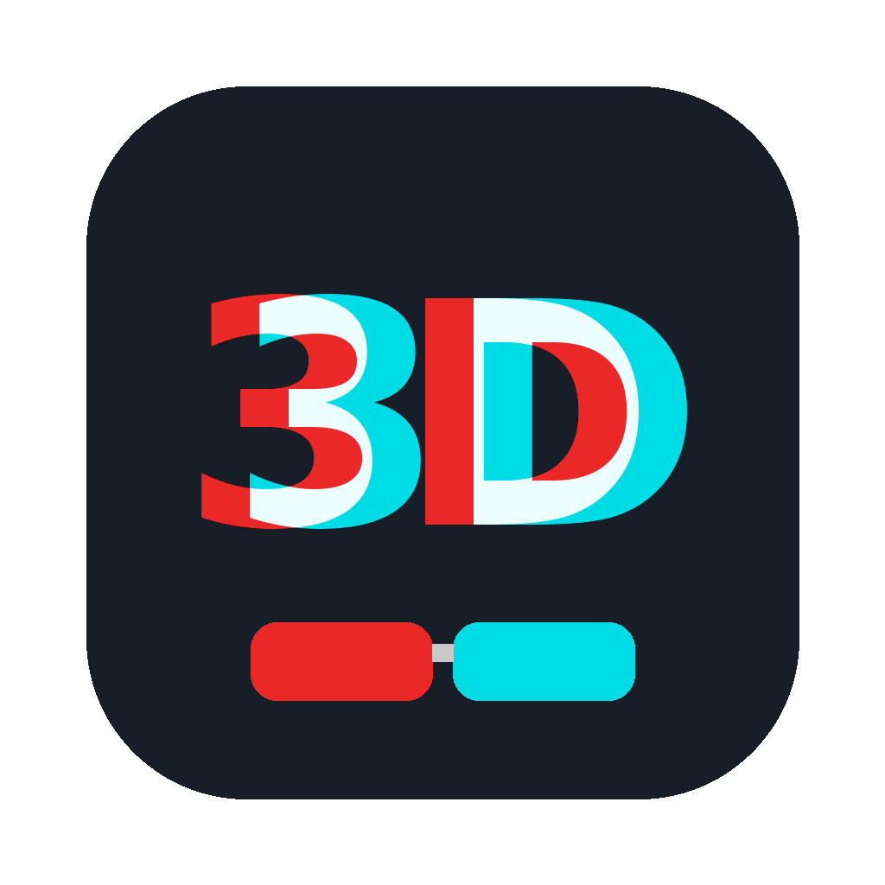

# Anaglyph Converter - by Dr Hrishikesh Sarkar

A simple Mac app that converts **top-and-bottom 3D surgical videos** (such as recordings from the Zeiss Kinevo 900 microscope) into **red-cyan anaglyph** videos. Anyone with inexpensive red-cyan 3D glasses can then watch them on a laptop or a normal projector.

Drag videos in, choose the settings, and click Convert. Each converted file is saved next to its original as `name_anaglyph.mp4`.



## Features

- Drag and drop videos, or a whole folder of them
- **Preview 3D** before converting, to check the depth through the glasses
- Choice of eye order (left or right eye on top)
- Three colour modes: Full colour (Dubois), Half colour, and Grey
- Three quality levels
- Progress bar and batch conversion
- Never overwrites existing files

## Requirements

- A Mac (Apple Silicon or Intel)
- [Homebrew](https://brew.sh)
- FFmpeg and Python with Tkinter, installed through Homebrew

## Installation

1. Install the required tools. Open **Terminal** and run:
   ```
   brew install ffmpeg python-tk
   ```

2. Download this project. Click the green **Code** button on this page, choose **Download ZIP**, and unzip it. Then move the folder somewhere permanent, such as your home folder.

3. Build the app. In Terminal, type `bash`, then a space, then drag `make_app.sh` from the folder into the Terminal window, and press **Enter**.

   When it prints **"Done!"**, an **Anaglyph Converter** icon appears on your Desktop.

4. Double-click the icon to open the app. If macOS warns that the app is from an unidentified developer, right-click the icon, choose **Open**, and click **Open** again. This is only needed the first time.

Keep the project folder after installing; the app runs from it.

## Usage

1. Drag one or more 3D videos onto the blue box.
2. Click **Preview 3D** and watch with the glasses, **red lens on the left eye**. Press **Q** to close the preview.
   - If instruments appear *behind* the tissue instead of in front, change **Eye order** to "Right eye on top".
3. Click **Convert**.

## Tips for projecting to an audience

- Darken the room and set the projector's colour mode to "Cinema" or "Standard".
- Seat viewers near the centre of the screen.
- Keep 3D clips short (3–5 minutes) to avoid eye strain.
- If tissue colours look dull on the projector, try the **Half colour** mode.

## How it works

The app is a small Python/Tkinter front end for FFmpeg's `stereo3d` filter:

```
ffmpeg -i input.mp4 -vf "stereo3d=ab2l:arcd" -c:v libx264 -crf 18 -c:a copy output.mp4
```

`ab2l` reads the input as above-below, half height, left eye on top. `arcd` writes red-cyan anaglyph using the Dubois method.

## Files

| File | Purpose |
|---|---|
| `anaglyph_converter.py` | The app |
| `make_app.sh` | Builds the clickable Mac app on your Desktop |
| `icon.png` | App icon |

## Author

Dr. Hrishikesh Sarkar — [getdrsarkar.com](https://getdrsarkar.com)
